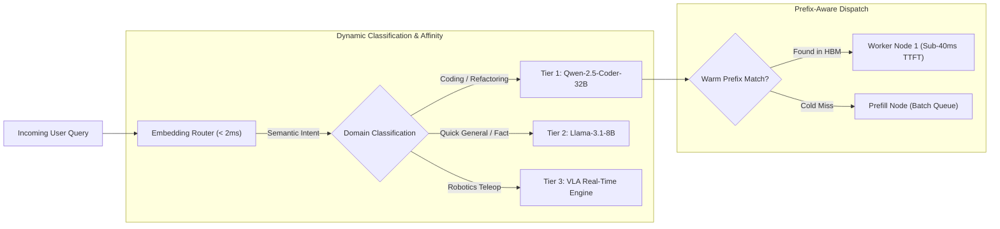

# Swizzle Router

<div align="center">

### Semantic Router, Matryoshka Embeddings & Prefix-Aware Cluster Load Balancer

**Fast Intent Classification (<2ms) · Warm Prefix KV Affinity · Hugging Face Hub Integration**

[](https://github.com/Swizzle-AI/swizzle-router)
[](https://huggingface.co/swizzle-ai)
[](https://swizzle-ten.vercel.app)
[](LICENSE)

</div>

---

## ⚡ What is Swizzle Router?

`swizzle-router` is a lightweight, ultra-fast semantic routing library engineered to direct incoming user queries to the optimal model and GPU worker. Unlike monolithic LLM routers that waste hundreds of milliseconds invoking an auxiliary LLM judge, Swizzle Router evaluates queries in **under $2	ext{ ms}$** using dense vector similarity and domain-adapted Matryoshka embeddings.



---

## 🚀 Key Features

1. **Sub-2ms Semantic Intent Classification**:
   * Uses trained dense encoder models (e.g. `ModernBERT`, `MiniLM-L12`) to map prompts against topic anchors without invoking generative models.
2. **Warm-Prefix Affinity Routing**:
   * Tracks content-addressed prefix hashes across worker nodes. Queries with shared system prompts or repository context are routed to workers that already hold the KV cache in GPU HBM.
3. **Matryoshka 2D Dimension Truncation**:
   * Embeddings trained with Matryoshka Representation Learning (MRL) allow dynamic dimension slicing (e.g. 64-dim for ultra-fast L1 filtering, 384-dim for precise boundary discrimination).
4. **Declarative Routing Configuration**:
   * Define intent boundaries, fallback thresholds, and model endpoints in standard YAML or Python code.

---

## 📦 Quickstart

### 1. Installation
```bash
pip install swizzle-router
```

### 2. Basic Semantic Routing Example
```python
from swizzle_router import SemanticRouter, Route

# Define routes with example prompt anchors
coding_route = Route(
    name="coding",
    utterances=[
        "write a python script to parse JSON",
        "fix the segmentation fault in this C++ function",
        "implement continuous batching in PyTorch"
    ],
    target_model="qwen-2.5-coder-32b"
)

fast_chat_route = Route(
    name="fast_chat",
    utterances=[
        "what is the capital of France?",
        "summarize this paragraph in 3 bullet points",
        "translate this greeting to Spanish"
    ],
    target_model="llama-3.1-8b"
)

router = SemanticRouter(routes=[coding_route, fast_chat_route])

# Route incoming query in < 2ms
result = router("How do I eliminate shared memory bank conflicts in CUDA?")
print(f"Target Route: {result.name} | Target Model: {result.target_model} | Score: {result.similarity:.3f}")
```

---

<div align="center">

**Part of the [Swizzle AI](https://github.com/Swizzle-AI) Ecosystem · Apache 2.0**

</div>
